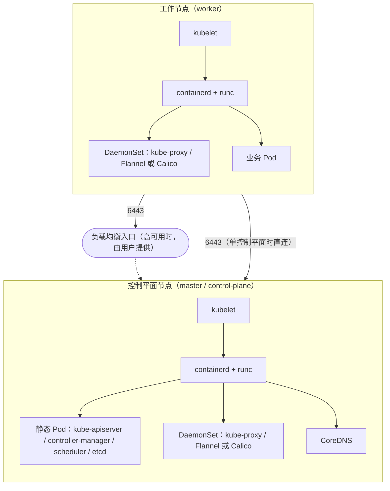
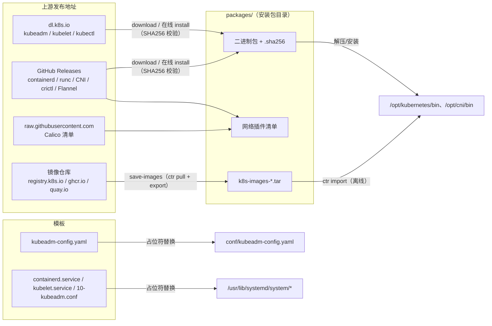
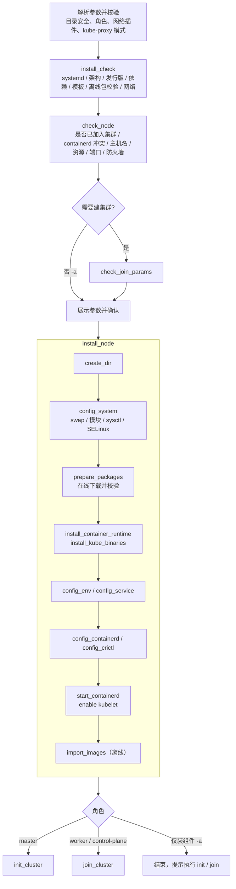
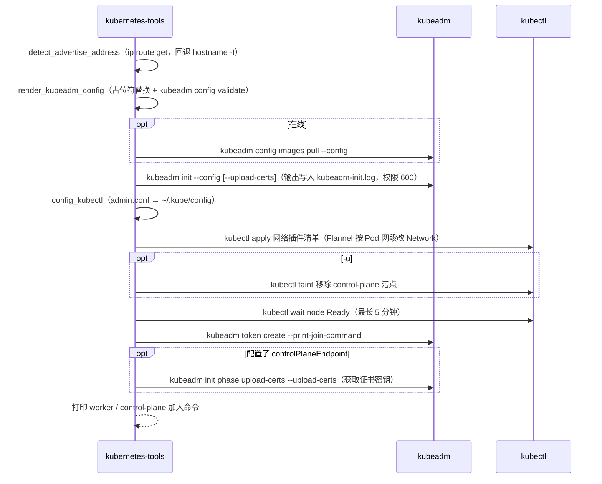
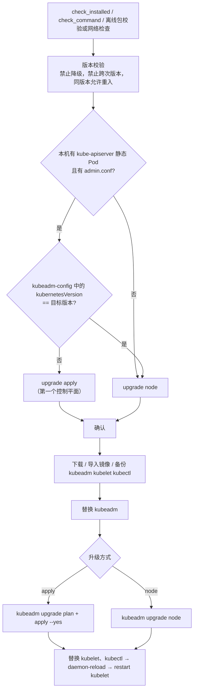
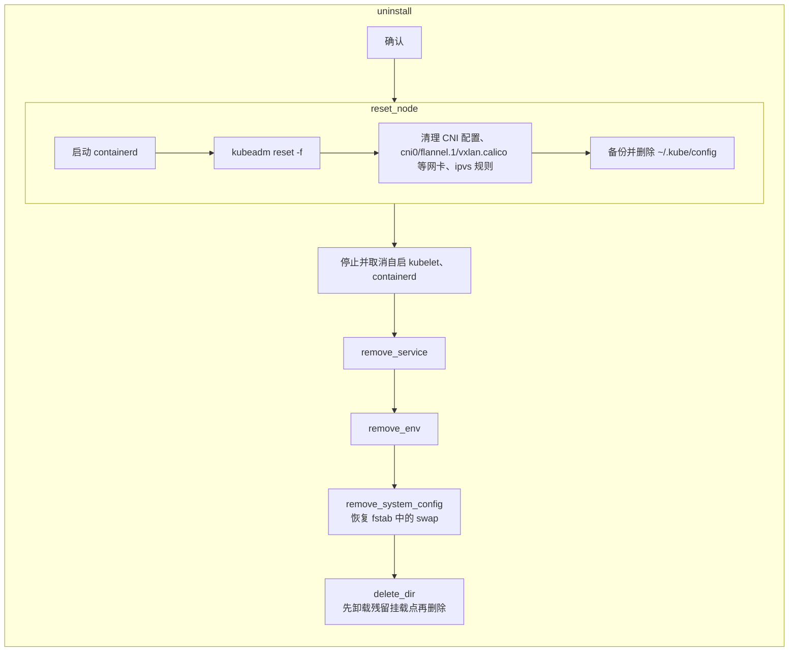
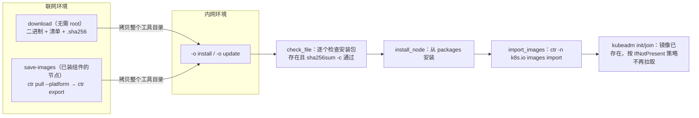

# kubernetes-tools 设计方案

本文档说明 kubernetes-tools 的设计目标、技术选型、总体架构、代码结构、核心流程和关键实现细节，供维护者和二次开发者参考。使用方法见 [README.md](README.md)。

## 1. 背景与目标

[docker-tools](../docker-tools/README.md) 用一个 Bash 脚本加若干模板文件，以静态二进制方式在 systemd 发行版上完成 Docker 的安装、更新和卸载。kubernetes-tools 沿用这套思路，把同样的体验带到 Kubernetes 集群部署上。

**目标**

| 编号 | 目标 | 说明 |
|---|---|---|
| G1 | 一键部署 | 一条命令完成单节点或多节点集群的组件安装和初始化或加入 |
| G2 | 与发行版无关 | 不依赖发行版软件源，RHEL / Debian / SUSE 系行为一致 |
| G3 | 在线/离线一致 | 在线和离线走同一套安装流程，只是安装包来源不同 |
| G4 | 完整生命周期 | 安装、初始化、加入、生成加入命令、重置、升级、卸载、服务管理 |
| G5 | 安全可回退 | 安装包做 SHA256 校验；修改系统文件前先备份；危险操作需确认；卸载时恢复系统配置 |
| G6 | 风格一致 | 命令格式、日志、参数风格、代码组织与 docker-tools 保持一致，降低学习和维护成本 |

**非目标**

- 不部署负载均衡（HAProxy / Keepalived），高可用入口由用户提供
- 不在多台机器之间编排（不做 SSH 批量执行），每台节点各自执行本工具
- 不管理集群内的应用（Ingress、存储、监控等）

## 2. 技术选型

### 2.1 部署方式：kubeadm

| 方案 | 优点 | 缺点 | 结论 |
|---|---|---|---|
| **kubeadm** | 官方工具；证书、静态 Pod、升级流程都由官方维护；社区资料多 | 需要准备容器运行时和 kubelet | ✅ 采用 |
| 纯二进制手工部署 | 完全可控 | 需要自己签发证书、编写各组件的 systemd 服务、维护升级逻辑，Shell 中难以写得可靠 | ❌ |
| 发行版软件包（pkgs.k8s.io） | 安装简单 | 不同发行版软件源不同，离线难做，与 G2、G3 冲突 | ❌ |
| k3s / RKE2 等发行版 | 开箱即用 | 不是上游原生 Kubernetes，组件形态不同 | ❌ |

kubeadm、kubelet、kubectl 取自 `dl.k8s.io` 的官方静态二进制，与 docker-tools 使用 Docker 静态包的思路一致。

### 2.2 容器运行时：containerd

| 方案 | 说明 | 结论 |
|---|---|---|
| **containerd + runc** | Kubernetes 主流 CRI 实现，有官方静态包，kubeadm 默认识别 | ✅ 采用 |
| Docker + cri-dockerd | 1.24 移除 dockershim 后需要额外的适配层，链路更长 | ❌ |
| CRI-O | 版本需要与 Kubernetes 次版本严格对齐，静态包生态较弱 | ❌ |

kubernetes-tools 使用独立的 containerd 服务，socket 为 `/run/containerd/containerd.sock`。docker-tools 安装的 Docker 由 dockerd 内部管理自己的 containerd，socket 位于 `/var/run/docker/containerd/`，两者可以共存。

### 2.3 网络插件

| 插件 | 说明 | 默认 |
|---|---|---|
| Flannel | 简单稳定，VXLAN 模式，单一清单部署 | ✅ |
| Calico | 支持 NetworkPolicy、BGP，清单部署会自动识别 kubeadm 配置的 Pod 网段 | 可选 |
| none | 不安装，由用户自行部署（如 Cilium） | 可选 |

两者都采用「清单文件 + `kubectl apply`」部署：清单是普通文件，可以随安装包一起离线分发。

### 2.4 其他关键选择

| 项目 | 选择 | 原因 |
|---|---|---|
| cgroup 驱动 | systemd（containerd 和 kubelet 统一） | kubeadm 默认值；与 systemd 管理的 cgroup 层级一致，避免两套 cgroup 管理器 |
| kubeadm 配置 | 模板 `kubeadm-config.yaml`（v1beta4）+ 占位符替换 | 与 docker-tools 的 `daemon.json` 模板思路一致；用户可以直接在模板里扩展任意 kubeadm 字段 |
| containerd 配置 | 运行时通过 `containerd config default` 生成，再用 sed 修改 | containerd 1.x 和 2.x 的配置格式差异很大，静态模板容易过时；基于当前版本的默认配置修改最稳妥 |
| 加入集群 | `kubeadm join` 命令行参数 | 参数少，Token、哈希、证书密钥可以直接从 `token` 命令的输出复制 |
| 下载工具 | 仅 `curl` | 减少依赖（docker-tools 同时依赖 curl 和 wget） |

## 3. 总体架构

### 3.1 节点组件



本工具在每个节点上负责：系统准备 → 安装二进制 → 生成配置 → 注册 systemd 服务 → 调用 kubeadm。控制平面组件以静态 Pod 运行，由 kubeadm 和 kubelet 管理，本工具不直接管理它们。

### 3.2 安装包与模板的数据流



在线安装时会先把安装包下载到 `packages/`，再从 `packages/` 安装；离线安装直接从 `packages/` 安装。两种方式只在「安装包从哪里来」这一步不同，后续流程完全相同（G3）。下载的安装包会留在 `packages/` 中，可以直接拷贝到其他节点做离线安装。

## 4. 目录与文件设计

### 4.1 工具目录

| 文件 | 作用 | 占位符 |
|---|---|---|
| `kubernetes-tools` | 主脚本 | — |
| `kubeadm-config.yaml` | kubeadm 配置模板：InitConfiguration、ClusterConfiguration、KubeletConfiguration、KubeProxyConfiguration | `ADVERTISE_ADDRESS` `CRI_SOCKET` `K8S_VERSION` `IMAGE_REPOSITORY` `CONTROL_PLANE_ENDPOINT` `POD_CIDR` `SERVICE_CIDR` `ETCD_DATA_DIR` `KUBE_PROXY_MODE` |
| `containerd.service` | containerd 服务，取自上游，`PATH` 加入安装目录 | `K8S_BIN_DIR` |
| `kubelet.service` | kubelet 服务，取自 kubernetes/release，依赖 containerd | `K8S_BIN_DIR` |
| `10-kubeadm.conf` | kubelet drop-in，加载 kubeadm 生成的参数 | `K8S_BIN_DIR` |
| `packages/` | 安装包目录，由 `download`、在线安装或 `save-images` 生成，不纳入版本库 | — |

模板文件统一通过 `SCRIPT_DIR`（脚本所在目录）定位，因此可以在任意目录执行脚本。docker-tools 要求在脚本所在目录执行，这一点做了改进。

### 4.2 安装包命名

文件名中包含版本和架构，这样同一个 `packages/` 可以同时存放多个版本和多个架构的安装包（用于升级和混合架构集群）：

| 安装包 | 文件名 |
|---|---|
| containerd | `containerd-<版本>-linux-<架构>.tar.gz` |
| runc | `runc-v<版本>.<架构>` |
| CNI 插件 | `cni-plugins-linux-<架构>-v<版本>.tgz` |
| crictl | `crictl-v<版本>-linux-<架构>.tar.gz` |
| kubeadm / kubelet / kubectl | `<组件>-v<版本>-linux-<架构>` |
| Flannel / Calico 清单 | `kube-flannel-v<版本>.yml` / `calico-v<版本>.yaml` |
| 离线镜像包 | `k8s-images-v<K8s 版本>-<网络插件>-linux-<架构>.tar` |
| 校验和 | `<安装包>.sha256` |

### 4.3 节点上的文件布局

| 路径 | 内容 | 可配置 |
|---|---|---|
| `<安装目录>/bin` | 全部二进制 | `-i` |
| `<安装目录>/conf` | 渲染后的 kubeadm 配置、初始化日志、网络插件清单 | `-i` |
| `<安装目录>/backup/<时间>` | 升级前备份的 kubeadm / kubelet / kubectl | `-i` |
| `<数据目录>/containerd` | containerd root（镜像、快照） | `-d` |
| `<数据目录>/etcd` | etcd 数据（ClusterConfiguration.etcd.local.dataDir） | `-d` |
| `/opt/cni/bin`、`/etc/cni/net.d` | CNI 插件和配置（约定路径，网络插件的 DaemonSet 会写入此处） | 脚本变量 |
| `/etc/containerd/config.toml`、`/etc/containerd/certs.d` | containerd 配置、镜像加速 | — |
| `/etc/kubernetes`、`/var/lib/kubelet` | kubeadm 和 kubelet 的约定路径 | — |
| `/etc/sysctl.d/kubernetes.conf`、`/etc/modules-load.d/kubernetes.conf` | 内核参数、内核模块 | — |

> 安装目录和数据目录与 docker-tools 的 `/opt/docker`、`/opt/docker/data` 对应。`/etc/kubernetes`、`/var/lib/kubelet`、`/opt/cni/bin` 是 kubeadm、kubelet 和网络插件写死的约定路径，修改它们会让 kubeadm 升级和网络插件出错，因此不提供配置项。

## 5. 代码结构

### 5.1 脚本分层

主脚本按「自上而下、底层到上层」组织，与 docker-tools 的分段方式一致：

```text
kubernetes-tools
├── 参数配置          版本号、目录、组件版本与下载地址、集群参数、开关变量
├── 日志颜色          COLOR_* 常量
├── 通用方法          log_*、backup_file、confirm_action、umount_under、strip_slash、version_lt
├── 检查              check_root/systemd/cpu_arch/os_release/command/file/package/net/dir_safe/node/join_params/installed/control_plane
├── 安装包            init_package_names、verify_package、download_file、download_packages、download_kube_packages、prepare_packages
├── 系统配置          create_dir/delete_dir、config_system/remove_system_config、config_env/remove_env、config_service/remove_service
├── 组件安装          install_container_runtime、install_kube_binaries、backup_kube_binaries、config_containerd、config_registry_mirrors、config_crictl、start_containerd
├── 镜像              get_pause_image、list_images、normalize_image、import_images
├── 集群操作          detect_advertise_address、render_kubeadm_config、config_kubectl、install_network_plugin、untaint_master、wait_node_ready、
│                     init_cluster、join_cluster、setup_cluster、print_join_command、reset_node
├── 服务管理          start/stop/restart/enable/disable_kubernetes、info_kubernetes
├── 流程编排（命令）  install、init、join、reset、uninstall、update、download、save_images（以及 install_node、print_params）
├── 参数解析          getopts（静默模式）+ 参数校验
└── 命令分发          case "${1:-help}"，按命令决定是否 check_root
```

### 5.2 分层约束

- **命令层**（如 `install`、`update`）只负责「检查 → 展示参数 → 确认 → 调用步骤函数」，不直接执行系统命令
- **步骤函数**（如 `config_containerd`）只完成一件事，开头和结尾打印 `----- 开始 / 完成 -----` 日志，与 docker-tools 一致
- **检查函数**失败时调用 `log_error` 直接退出，在修改系统之前尽早失败
- **全局变量**只在「参数配置」区声明，由 getopts 和 `init_package_names` 赋值，其他函数只读（`detect_advertise_address` 回填 `ADVERTISE_ADDRESS` 除外）
- 不在 `$(...)` 中调用 `log_error`：子 shell 中的 `exit` 只会退出子 shell，不会中止脚本

### 5.3 与 docker-tools 的对应关系

| docker-tools | kubernetes-tools | 说明 |
|---|---|---|
| `check_cpu_arch` | `check_cpu_arch` + `resolve_package_arch` | 增加 amd64/arm64 名称换算，以及 `-b` 跨架构下载 |
| `check_net` / `check_url_reachable` | 同名 | 只请求 1 个字节（`-r 0-0`），检查的是校验和文件 |
| `download_docker_engine_package` | `download_file` + `download_packages` | 通用下载函数：重试、`.part` 临时文件、SHA256 校验、生成 `.sha256` |
| `config_system` | `config_system` | 增加关闭 swap、SELinux、ipvs 模块 |
| `config_docker_engine`（daemon.json 模板） | `config_containerd`（基于默认配置修改）+ `render_kubeadm_config`（模板） | |
| `config_service` | `config_service` | 三个模板：containerd、kubelet、drop-in |
| `_write_env_block` / `remove_env` | 同名 | 块标记改为 `# Kubernetes Env Begin/End`，幂等写入 |
| `only_enable_docker_swarm` | `init_cluster` / `join_cluster` | 角色由 manager/worker 扩展为 master/worker/control-plane |
| `-s` 安装后启用 Swarm | 默认安装后建集群，`-a` 只装组件 | 默认行为反过来：Kubernetes 的组件单独装好也无法使用 |
| — | `download`、`save-images`、`token`、`reset`、`init`、`join` | 新增命令 |

### 5.4 命令与参数设计

参数风格沿用 docker-tools 的「单字母参数 + 末尾命令」，并尽量保留相同字母的含义：

| 参数 | docker-tools 含义 | kubernetes-tools 含义 |
|---|---|---|
| `-v` | Docker 版本 | Kubernetes 版本 |
| `-i` / `-d` | 安装目录 / 数据目录 | 同左 |
| `-r` | Swarm 角色 manager/worker | 节点角色 master/worker/control-plane |
| `-m` | Swarm Manager IP | 要加入的集群 API Server 地址 |
| `-t` | Swarm Token | 加入集群的 Token |
| `-a` | 仅安装 Docker Engine | 仅安装组件 |
| `-p` / `-n` | 离线安装包名 | Pod 网段 / 网络插件（离线改用 `-o` + 目录约定，原因见 6.5） |

新增参数：`-o` 离线、`-k` 安装包目录、`-b` 安装包架构、`-l` 本机地址、`-e` 控制平面入口、`-s` CA 哈希、`-c` 证书密钥、`-x` Service 网段、`-g` 镜像仓库、`-w` 镜像加速、`-u` 控制平面可调度、`-y` 跳过确认。

`getopts` 使用静默模式（optstring 以 `:` 开头），由脚本自己处理「未知选项」和「缺少参数值」。docker-tools 的 `:)` 分支在非静默模式下不会触发。

## 6. 核心流程

### 6.1 install



### 6.2 init_cluster



`print_join_command` 解析 `kubeadm token create --print-join-command` 的输出，生成可以直接复制执行的 `kubernetes-tools ... install` 命令。是否打印控制平面加入命令，取决于集群的 kubeadm-config ConfigMap 中是否配置了 `controlPlaneEndpoint`。

### 6.3 update（升级）



判断依据：`kubeadm upgrade apply` 成功后会把 kubeadm-config 中的 `kubernetesVersion` 更新为目标版本。因此，如果某个控制平面节点读到的集群版本还不是目标版本，它就是第一个升级的节点；否则执行 `upgrade node`。这样所有节点都执行同一条命令，不需要用户区分。

### 6.4 reset 与 uninstall



`reset` 只让节点退出集群，保留已安装的组件，用于初始化或加入失败后重试；`uninstall` 在 `reset` 的基础上删除全部内容。

### 6.5 离线方案



- docker-tools 只有 2 个安装包，用 `-p`、`-n` 分别指定文件名。kubernetes-tools 有 7 个以上的安装包，改为「`-o` + 安装包目录 + 文件命名约定」，由版本和架构推导出文件名
- 镜像导出需要可用的 containerd，所以单独提供 `save-images` 命令，在执行过 `-a install` 的联网节点上运行
- `save-images` 调用与目标版本一致的 kubeadm（`kubeadm config images list`）获取组件镜像列表，再从网络插件清单中解析 `image:` 字段。这样镜像列表和版本始终一致，不在脚本中硬编码
- 镜像导出到 containerd 的 `k8s.io` 命名空间（CRI 使用的命名空间），导入后 kubelet 可以直接使用

## 7. 关键设计细节

### 7.1 containerd 配置

先用 `containerd config default` 生成默认配置，再做 4 处修改：

| 修改 | 实现 | 兼容性 |
|---|---|---|
| 数据目录 | `^root = ` → `<数据目录>/containerd` | 1.x / 2.x |
| systemd cgroup | `SystemdCgroup = false` → `true`，修改后 grep 校验，失败则报错退出 | 1.x / 2.x |
| 镜像加速目录 | `.registry]` 段内的 `config_path` → `/etc/containerd/certs.d` | 1.x / 2.x |
| pause 镜像 | `sandbox`（2.x）或 `sandbox_image`（1.x）→ `kubeadm config images list` 中的 pause 镜像 | 1.x / 2.x |

pause 镜像从 kubeadm 获取，所以 containerd 使用的 pause 版本和仓库（`-g`）始终与 kubeadm 期望的一致，避免 kubeadm 的预检警告和额外的镜像拉取。

### 7.2 镜像加速

`-w docker.io=https://a,docker.io=https://b,ghcr.io=https://c` 会生成：

```toml
# /etc/containerd/certs.d/docker.io/hosts.toml
server = "https://registry-1.docker.io"

[host."https://a"]
  capabilities = ["pull", "resolve"]

[host."https://b"]
  capabilities = ["pull", "resolve"]
```

这是 containerd 官方推荐的 hosts 配置方式。同一仓库可以配置多个加速地址；`save-images` 中的 `ctr pull --hosts-dir` 也使用同一套配置。

### 7.3 安装包校验

- `download_file` 先下载到 `<文件>.part`，校验通过后再改名，避免中断后留下不完整的文件
- 支持两种校验和格式：「哈希 + 文件名」（containerd、CNI、runc，runc 的校验和文件带 PGP 签名）和「只有哈希」（dl.k8s.io、crictl）
- 校验通过后生成 `<文件>.sha256`。之后无论是重复下载还是离线安装，都用 `sha256sum -c` 重新校验；校验失败时，在线模式会重新下载，离线模式会报错退出

### 7.4 幂等与备份

| 操作 | 幂等方式 |
|---|---|
| 环境变量 | 先删除已有的 `# Kubernetes Env Begin/End` 块，再写入 |
| sysctl / modules / containerd / kubeadm 配置 | 整个文件重写，重写前备份为 `*.bak.<时间>` |
| fstab | 只注释未注释的 swap 行，并加上 `#[kubernetes-tools]` 前缀；卸载时只恢复带这个前缀的行 |
| 下载 | 已存在且校验通过的文件直接跳过 |
| 重复安装 | `check_node` 检测到 `kubelet.conf` 或 `admin.conf` 时拒绝安装，提示先执行 `reset` |
| 升级 | kubeadm 已是目标版本时允许继续，用于完成上次中断的升级 |

### 7.5 安全设计

- **目录保护**：`-i`、`-d` 必须是绝对路径，且不能是 `/`、`/opt`、`/usr`、`/var` 等系统目录，防止 `uninstall` 中的 `rm -rf` 误删
- **服务冲突检测**：已存在不带 `# Managed by kubernetes-tools` 标识的 `containerd.service` 时拒绝安装，避免覆盖通过软件包安装的 containerd
- **敏感信息**：Token 和证书密钥在参数日志中显示为 `******`；`kubeadm-init.log` 在 `umask 077` 下创建；`~/.kube/config` 权限为 600
- **危险操作确认**：`install`、`init`、`join`、`reset`、`uninstall`、`update` 都需要确认；在非交互环境中读不到输入时，提示使用 `-y`，而不是静默退出
- **最小 root**：`help`、`version`、`download` 不需要 root，其余命令在分发前检查 root
- **不自动清理 iptables**：`kubeadm reset` 不会清理 iptables 规则，本工具也不自动执行 `iptables -F`，以免误删本机的其他规则（如 Docker、防火墙），只打印清理命令供用户自行执行

### 7.6 健壮性

- 全局 `set -euo pipefail`；需要容错的命令显式写 `|| true` 或 `|| log_warning`
- 读取 `/etc/os-release` 放在子 shell 中，避免其中的 `VERSION` 等变量覆盖脚本自身的变量
- 脚本中定义了 `install` 函数，因此调用 coreutils 的 install 时一律写 `command install`
- `start_containerd` 轮询 socket 和 `crictl info`（最长 30 秒），确认就绪后再继续
- kubelet 在 kubeadm 运行前只 `enable` 不 `start`，由 kubeadm 启动，避免无意义的重启日志
- `delete_dir` 先按由深到浅的顺序卸载 `/var/lib/kubelet`、数据目录和 `/run/containerd` 下的残留挂载点，再删除目录

## 8. 兼容性

| 维度 | 范围 | 说明 |
|---|---|---|
| 初始化机制 | systemd | `check_systemd` 检查 `/run/systemd/system` |
| CPU 架构 | x86_64、aarch64 | 与 docker-tools 一致；`-b` 支持跨架构下载 |
| Kubernetes | 1.31+ | 模板使用 kubeadm v1beta4 API（1.31 引入）。更早的版本需要把模板改为 v1beta3 |
| containerd | 1.7、2.x | 配置修改兼容两种格式 |
| 发行版 | RHEL / Debian / SUSE 系 | 依赖提示自动识别 dnf、yum、zypper、apt-get |
| cgroup | v1、v2 | 统一使用 systemd 驱动。containerd 2.2+ 对 cgroup v1 会给出弃用警告 |

## 9. 测试方案

### 9.1 已完成的验证

| 类别 | 内容 | 结果 |
|---|---|---|
| 静态检查 | `bash -n`；`shellcheck -S warning` | 通过 |
| 参数解析 | 未知选项、缺少参数值、非法角色、`-i /`、`-i /opt/`（系统目录） | 均给出正确提示 |
| download | 实际下载 1.37.1 全部安装包（amd64 + arm64，Flannel + Calico）；SHA256 校验（含 runc 的 PGP 签名校验和文件）；重复执行时跳过；篡改文件后自动重新下载 | 通过 |
| 离线校验 | 篡改的安装包被 `check_package` 拒绝；缺少安装包时给出提示 | 通过 |
| containerd 配置 | 用 containerd 2.4.2 实际生成并修改配置：root、`SystemdCgroup = true`、`sandbox = '<仓库>/pause:3.10.2'`、`config_path`；镜像加速 hosts.toml（同一仓库配置多个加速地址） | 通过 |
| containerd 运行 | 用生成的配置启动 containerd 2.4.2，`crictl info` 正常；拉取镜像时会走 `certs.d` 中配置的加速地址 | 通过 |
| 镜像导入导出 | 在 `k8s.io` 命名空间执行 `ctr images import/export --platform`，导入后 `crictl images` 可见 | 通过 |
| kubeadm 配置 | 渲染模板（含与不含 `-e`、ipvs 模式），`kubeadm config validate` 通过；`kubeadm config images list --config` 能输出正确的仓库和版本 | 通过 |
| 函数单测 | `normalize_image`、`list_images`、Flannel 网段替换、加入命令解析、`version_lt`、`check_join_params` 的各种缺参和格式错误 | 通过 |

### 9.2 建议的集成测试矩阵

开发环境的沙箱中没有 systemd，也无法访问 registry.k8s.io，因此端到端流程需要在虚拟机中验证：

| 场景 | 发行版 | 验证点 |
|---|---|---|
| 单节点 `-u install` | Rocky 9、Ubuntu 24.04、openSUSE Leap 15.6 | 节点 Ready，CoreDNS Running，可以调度业务 Pod |
| 一主两从 | Debian 12 | `token` 输出的命令可以直接执行；跨节点 Pod 互通 |
| 高可用 3 控制平面 | Rocky 9 + HAProxy | `-e` 与 control-plane 加入；停掉一个控制平面后集群仍可用 |
| 离线安装 | 断网虚拟机 | 只用 `packages/` 完成安装，全程没有外网请求 |
| 升级 | 1.36.x → 1.37.x | 第一个控制平面执行 apply，其他节点执行 node；业务不中断 |
| Calico、nftables | Ubuntu 24.04 | `-n calico`、`KUBE_PROXY_MODE=nftables` |
| 卸载 | 全部 | 无残留服务、挂载点和网卡；fstab 恢复；可以重新安装 |
| arm64 | Ubuntu 24.04 arm64 | 安装和离线流程 |

## 10. 已知限制与后续规划

| 限制 | 说明 | 规划 |
|---|---|---|
| 不部署负载均衡 | 高可用需要用户自备 VIP 或负载均衡 | 可选内置 kube-vip 静态 Pod |
| 单机执行 | 每台节点都要单独执行 | 增加基于 SSH 的批量部署 |
| `update` 只升级 Kubernetes 组件 | containerd、runc、CNI 需要手动替换 | 增加运行时升级命令 |
| 仅支持 IPv4 | 地址探测和 `-m` 默认端口拼接按 IPv4 处理 | 支持 IPv6 和双栈 |
| 仅提供中文文档 | docker-tools 有中、英、日三语文档 | 补充 README_EN、README_JA |
| 不自动 drain | 升级和卸载前需要在控制平面手动 drain | 在控制平面节点上提供 drain/uncordon 封装 |
